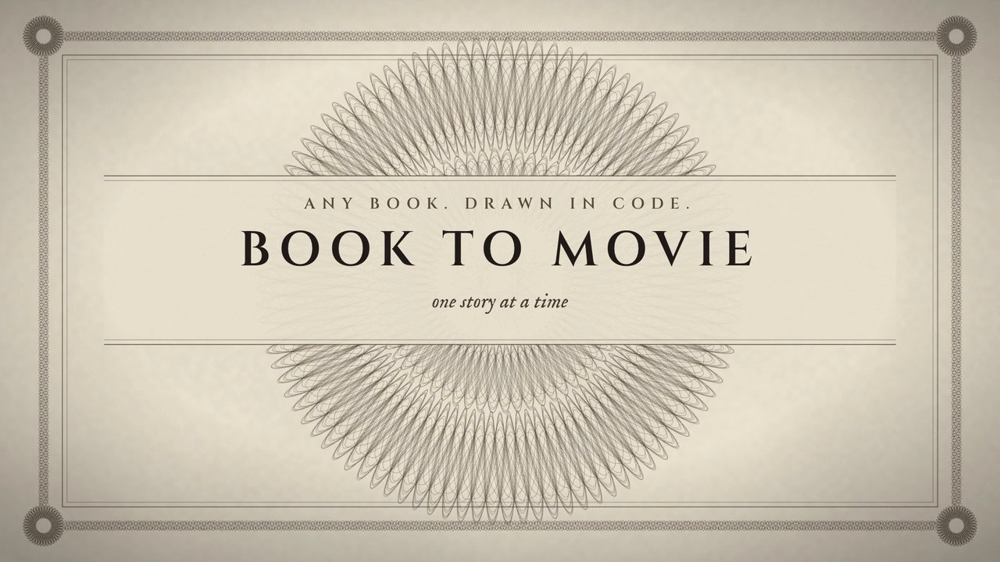
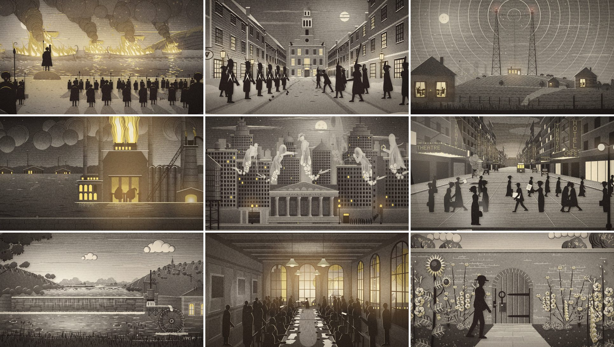
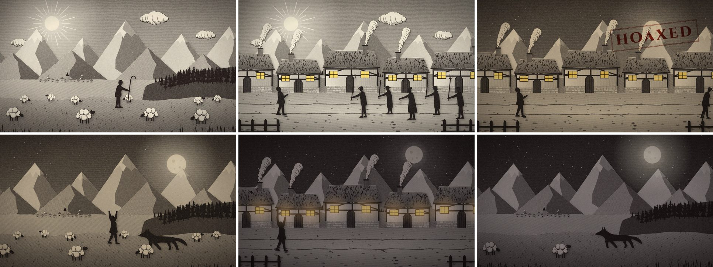
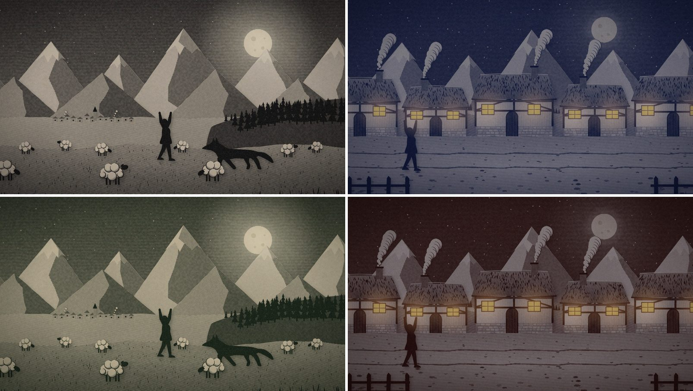

<p align="center">
  
</p>

# Book to Movie

Turn any book into an illustrated, narrated film. Claude writes the script and draws every frame in code.

Video models can make you a gorgeous eight seconds. They can't make you two hours. The characters drift, the look wanders, the bill climbs, and changing one line means starting again.

So this doesn't generate video at all. Claude reads your book, finds one story for each part of it, writes the narration, then draws every scene as code: SVG drawings that a small engraving engine prints as hatched paper cutouts, stacked into a little theatre and filmed with a slow parallax camera. Actions land on the words that name them. Any frame can be re-rendered exactly. It looks like one hand drew the whole thing, because one process did.

It was built to make a 1 hour 48 minute film of a 92,000-word book. No image or video model touched it, and the narration and sound effects for the whole film cost about $17. Point it at your favourite public-domain novel. Hack on it. Make it yours. Enjoy.



<sub>Stills from that film, of the 1937 edition of *Think and Grow Rich* (in the US public domain). Every line is code. Not affiliated with the Napoleon Hill Foundation, which owns the title as a trademark.</sub>

## Quickstart (30-second setup)

You need [Claude Code](https://claude.com/claude-code), ffmpeg, librsvg and Node 22 or newer. `setup.sh` checks for them and offers to install what's missing.

```bash
git clone https://github.com/0xadvait/book-to-movie
cd book-to-movie
./setup.sh
```

**See it work, free, no keys:**

```bash
./movie demo
```

That makes a one-minute film of an Aesop fable, narrated by your computer's own voice. The first run takes a few minutes because it downloads a speech model and a headless browser. Every drawing in it is Python you can read in [`examples/the-shepherds-boy`](examples/the-shepherds-boy).



**Now your book:**

```bash
claude
> /book-to-movie ~/Books/my-book.pdf
```

Claude reads it and shows you a plan. You approve. It makes part one completely, and you watch it. You approve again, or send it back. Only then does it make the rest.

> [!TIP]
> Put a `FAL_KEY` or `ELEVENLABS_API_KEY` in `.env` for a real narrator and sound effects. Without one you get your computer's voice, which is plenty for deciding whether you like the pilot. `./movie cost` shows the audio bill before anything is spent.

> [!WARNING]
> Only adapt books that are public domain or yours to adapt. Check first: a book being easy to download says nothing about its copyright, and public domain differs by country.

## How it works

| Stage | Who does it | What happens |
|---|---|---|
| **Read** | `./movie new` | PDF, EPUB, text, Word or HTML into chapters. Contents pages and page furniture are told apart from the book. |
| **Plan** | Claude, then you | `TREATMENT.md`: which story each part tells, and the look. |
| **Write** | `screenwriter` agents | Narration, an art plan and a sound plan. `./movie check` refuses a broken script before a cent is spent. |
| **Voice** | ElevenLabs, or a free voice | One clip per scene, each told its neighbours' words so the delivery flows. Whisper times every word against the script. |
| **Draw** | `illustrator` agents | Python writes tone-coded SVG layers. The engraver turns tone into line. |
| **Move** | [HyperFrames](https://github.com/heygen-com/hyperframes) | A JSON spec per scene: layers, camera, effects, all timed to spoken words. Rendered from HTML to video. |
| **Mix** | `./movie mix` | Voice first. Every line levelled, a printed per-line audit, mastered to -16 LUFS. |
| **Cut** | ffmpeg | Dissolves inside a story, dips through black between stories, chapter markers, no drift at the joins. |

<details>
<summary><strong>What a drawing looks like</strong></summary>

You draw in grey. Luminance becomes line density, and `data-h` says which way the lines run. The engraver does the rest.

```python
from book_to_movie.art import Set
from book_to_movie.figures import figure
from book_to_movie.svgkit import gray, lin, puff

s = Set(__file__)

sky = lin("sky", [(0, gray(0.56)), (1, gray(0.05))])
s.layer("sky", '<rect x="-100" y="-60" width="2120" height="1200" fill="url(#sky)" data-h="0,1"/>' + puff(1250, 170, 44), sky)
s.layer("boy", figure("cry", child=True, hat="none", x=960, y=872, height=210))
s.done()
```

</details>

<details>
<summary><strong>What a scene looks like</strong></summary>

Times are seconds, or the word that makes the thing happen. The crowd below starts running when the narrator says "running". Re-voice the line and they still do.

```json
{
  "id": "s03-shout", "set": "village",
  "layers": [
    {"name": "sky", "src": "sky.png", "z": 0.0},
    {"name": "houses", "src": "houses.png", "z": 0.3},
    {"name": "crowd", "frames": {"srcs": ["run1.png", "run2.png"], "fps": 7}, "z": 0.65,
     "move": [{"t": "cue:running", "x": 1700}, {"t": "cue:laughed", "x": 0, "ease": "power1.out"}]},
    {"name": "fg", "src": "fg.png", "z": 1.0}
  ],
  "camera": [{"t": 0, "x": -60, "zoom": 1.05}, {"t": "end", "x": 30, "zoom": 1.0}],
  "text": [{"type": "stamp", "text": "HOAXED", "at": "cue:hoaxed", "x": 1090, "y": 200}]
}
```

</details>

## Why it works

Every rule in here is scar tissue from making a feature-length film this way.

### #1: A chapter is not a story

> "The plot, being an imitation of an action, must imitate one action and that a whole."
>
> -- Aristotle, *Poetics*, translated by S. H. Butcher

**The Problem:** Summarise a book chapter by chapter and you get a lecture with pictures.

**The Fix:** One story per part. For non-fiction, the author's best anecdote for that idea. For fiction, the plot's spine, grouped so each part has its own turn. Every part opens on a scene, never on a definition. And nothing gets invented: the screenwriter reads every word, quotes verbatim, and dramatises with pictures, not claims.

### #2: The eight-second trap

> "What they finally remember is not the editing, not the camerawork, not the performances, not even the story -- it's how they felt."
>
> -- Walter Murch, *In the Blink of an Eye*

**The Problem:** Video models optimise the shot, but a film is felt across hours. A world that keeps changing breaks the spell, and an uncanny face breaks it faster.

**The Fix:** Silhouettes on engraved paper, a trick as old as [Lotte Reiniger's films of the 1920s](https://en.wikipedia.org/wiki/The_Adventures_of_Prince_Achmed). The same engraver, figure library and palette run through every scene, so minute 100 matches minute 1. Everything is seeded, so any frame re-renders exactly.

### #3: Pictures that don't know what's being said

> "the spontaneous and irresistible weld"
>
> -- Michel Chion, *Audio-Vision*, on what happens when a sound and an image land at the same moment

**The Problem:** Most narrated video changes picture somewhere near the line. You feel the slack without being able to name it.

**The Fix:** Whisper times every word, and those times are mapped back onto the script's own spelling. A spec says `"t": "cue:running"`, so the crowd moves on that word. Edit a line and re-voice it, and the picture follows.

### #4: Music that drowns the voice

> "There are voices, and then everything else."
>
> -- Michel Chion, *The Voice in Cinema*

**The Problem:** The generated score was $69 of the $86 audio bill on that film, it kept fighting the narrator, and in the end it was cut. The film is better without it.

**The Fix:** Music is off by default and refuses to spend without `--allow-spend`. Every line is levelled to one loudness, effects are placed relative to the voice, and the mix prints what it did per line, so balance is measured, not guessed. If you do switch music on, it sits 12 dB under every line.

### #5: Finding out at minute ninety

> "Early on, all of our movies suck."
>
> -- Ed Catmull, *Creativity, Inc.*

**The Problem:** Rendered work is expensive, and the first version of anything is wrong. On that film the first verdict was "a bit slow".

**The Fix:** Two gates: the plan, then one complete pilot. And nothing is paid for twice. A scene only re-renders when its composition or images change. A clip is only re-voiced when its words change. Pace is one number, and changing it costs nothing.

## Make it yours

Ink and paper are one setting. The same drawings below, four palettes:



```json
{
  "title": "Moby-Dick",
  "author": "Herman Melville",
  "period": "1850s whaling ships and New England harbours",
  "look": "indigo",
  "voice": {"provider": "auto", "name": "Bill", "speed": 1.12, "tempo": 1.07, "respell": {}},
  "music": false,
  "sfx": true
}
```

`look` is `sepia`, `noir`, `indigo`, `forest`, `oxblood`, or your own `{"paper": "#...", "ink": "#...", "accent": "#..."}`. `period` tells the illustrators what to draw. `name` is any ElevenLabs voice. `respell` fixes a word only after you've heard the voice get it wrong: forced respellings usually sound worse. Drop in other fonts by adding them to `film/assets/fonts/fonts.txt` and naming them in `"fonts"`.

<details>
<summary><strong>Every command</strong></summary>

Claude runs these for you. You can too.

| Command | What it does |
|---|---|
| `./movie doctor` | Check this machine has what it needs |
| `./movie demo` | Make the one-minute example film, free |
| `./movie new <book>` | Start a project and find its chapters |
| `./movie status` | Where the project stands, and what to do next |
| `./movie cost` | Estimate the audio bill before spending anything |
| `./movie check N` | Check a script: digits, dashes, unspoken card text, missing scenes |
| `./movie voice N` | Narration, word timing, scene timing, and the title, chapter and quote cards |
| `./movie sfx N` | Sound effects |
| `./movie sheet N` | What is left to illustrate in a part |
| `./movie art N <set>` | Run a drawing script and engrave its layers |
| `./movie preview N <set>` | A still of a set's layers, composited |
| `./movie figures` | A reference sheet of every figure pose and hat |
| `./movie scene N <id>` | Render a scene and pull check frames to look at |
| `./movie finish N` | Render what changed, mix, join, check |
| `./movie contact N` | A contact sheet of a part's scenes |
| `./movie film` | Join all parts into the film, with chapter markers |
| `./movie phone film` | A small copy for sending |
| `./movie portrait N <slug> "File:..."` | Engrave a portrait from a public-domain Wikimedia Commons file (it refuses anything else) |
| `./movie music N --allow-spend` | Generate score cues |

</details>

## What it costs

Real numbers from the 15-part film this was built for.

| | Per part | Whole film |
|---|---|---|
| **Length** | 6 to 12 minutes | 1 hour 48 minutes |
| **Narration and effects** (fal) | about $1 | about $17 |
| **Music**, if you must (fal, $0.60 a minute) | about $5 | $69 |
| **Claude** | about seven illustrator agents, 3.7M tokens on the pilot. 3 to 6% of a weekly Claude Max allowance. | Roughly half to most of a week's allowance |
| **Disk** | | 76 GB while working, 11.7 GB for the finished film |
| **Render time** | about 30 seconds per 20-second scene on a 12-core laptop | overnight, in waves |

The demo costs nothing. Keeping sets few and returning to places, which the briefs push hard, is where the Claude budget is won or lost.

## What's in the box

| | |
|---|---|
| [Claude Code](https://claude.com/claude-code) | The director, the screenwriters and the illustrators. A skill and two agent briefs in [`.claude/`](.claude). [`AGENTS.md`](AGENTS.md) points other coding agents at the same briefs. |
| `book_to_movie/` | The engraver, figure library, card maker, scene compositor, mixer and cutter, and the `./movie` command. |
| [ElevenLabs](https://elevenlabs.io), direct or through [fal](https://fal.ai) | Narration and sound effects. Optional. |
| [Whisper](https://github.com/openai/whisper) | Word timing and the final check, through [mlx-whisper](https://github.com/ml-explore/mlx-examples) on Apple Silicon or [faster-whisper](https://github.com/SYSTRAN/faster-whisper) elsewhere. |
| [HyperFrames](https://github.com/heygen-com/hyperframes) + [GSAP](https://gsap.com) | HTML to video, frame-accurately. |
| ffmpeg, librsvg, OpenCV | The cut, the rasteriser and the portrait engraver. |
| [Cinzel](https://github.com/NDISCOVER/Cinzel) and [IM Fell English](https://iginomarini.com/fell/) | The type. |

## Honest limits

- **It's a narrated picture book that moves, not a live-action movie.** One narrator, silhouettes, no lip sync. That's the point of the look, and also its ceiling.
- **It needs your eye.** The approval gates aren't decoration. Claude will happily ship a pilot that's too slow.
- **It's been run end to end on macOS on Apple Silicon.** [CI](.github/workflows/ci.yml) runs the tests and makes the demo film on Ubuntu on every push. Windows isn't supported.
- **English is the only language tested end to end.** Whisper and the voices handle many more, but the shipped fonts cover Latin script only, and word timing assumes spaces between words.
- **A scanned PDF needs OCR first**, and chapter detection will sometimes need a hint (`--heading 'REGEX'`).
- **The free voices sound like computers.** Good for a pilot, not for a premiere. Audio you generate is subject to your provider's terms: check that your plan allows what you intend to do with it.

## Keys and privacy

Keys are read only from your environment or a git-ignored `.env`. Your books, audio and films live in `projects/`, also git-ignored. A [test](tests/test_repo_is_clean.py) fails if a credential or personal path ever lands in this repo, and CI runs [gitleaks](https://github.com/gitleaks/gitleaks) on every push. Your book's text goes to Claude, and its narration script to your voice provider if you use one.

## License

[MIT](LICENSE). The shipped fonts are under the [SIL Open Font License](book_to_movie/assets/fonts). HyperFrames (Apache 2.0) and GSAP are fetched when you render, under their own terms.

What you make is yours, subject to the rights in the book you started from.
